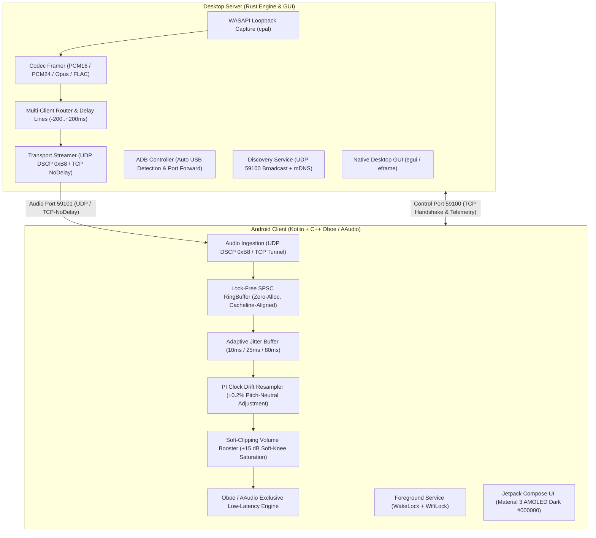

# ⚡ ZERO PULSE LINK

**A Production-Grade, Lossless Open-Source Alternative for PC-to-Phone Audio Streaming**

**Zero Pulse Link** is an ultra-low-latency audio streaming suite that transforms your Android smartphone into a lossless wireless and wired speaker (and microphone) for your PC. 

---

### 💡 Why Zero Pulse Link Exists: The Story Behind the Project

> *"Modern smartphone speakers are fantastic—dynamic, stereo, loud, and crisp—while most laptop speakers are quiet and tinny. Existing commercial apps that let you use your phone as a PC speaker charge recurring subscriptions or steep one-time fees. While that may seem small in some countries, for students, developers, and everyday users in India and emerging economies, that is a lot of money.*
> 
> *I couldn't afford to pay those recurring fees, but I knew I could build a solution myself. I created **Zero Pulse Link** so that anyone, anywhere in the world, can use their phone as a high-fidelity speaker and microphone completely free.*
> 
> * **100% Free & Open-Source**: Licensed under the permissive MIT license.
> * **Zero Data Recorded**: No telemetry, no usage analytics, no audio recording. Everything streams exclusively peer-to-peer over your local Wi-Fi or direct USB cable.
> * **Zero Artificial Restrictions**: Uncompressed lossless audio, multi-device streaming, and direct USB wired mode without carrier tethering plans.
> 
> *Made with ❤️ from India for the global community. Enjoy!"*
> — **MD Yousuf**

---

### 📥 Pre-Compiled Downloads (GitHub Actions & Pre-Releases)

Pre-compiled standalone binaries for every commit and release are automatically built and published:
* **Windows PC Application**: [Download `ZeroPulseLink-Windows-x86_64.exe`](https://github.com/MDYOUSUF20007-oss/ZERO-Pulse-link/releases)
* **Android Client App**: [Download `ZeroPulseLink-Android.apk`](https://github.com/MDYOUSUF20007-oss/ZERO-Pulse-link/releases)

You can also download automated build artifacts from any run in the **[GitHub Actions](../../actions)** tab under the `Artifacts` section.

---

## 📑 Table of Contents
1. [Key Features](#-key-features)
2. [Architecture & Tech Stack](#-architecture--tech-stack)
3. [Wire Protocol Specification](#-wire-protocol-specification)
4. [Audio Engineering Deep Dive](#-audio-engineering-deep-dive)
   - [Lock-Free SPSC Ring Buffer](#1-lock-free-spsc-ring-buffer)
   - [Adaptive Jitter Buffer & Buffer Profiles](#2-adaptive-jitter-buffer--buffer-profiles)
   - [Clock Drift Compensation (PI Resampler)](#3-clock-drift-compensation-pi-resampler)
   - [Dynamic Packet Loss Concealment (PLC)](#4-dynamic-packet-loss-concealment-plc)
   - [Soft-Knee Volume Boost (+15dB Limiter)](#5-soft-knee-volume-boost--15db-limiter)
5. [Multi-Device Simultaneous Streaming](#-multi-device-simultaneous-streaming)
6. [One-Click USB Wired Mode (Direct ADB)](#-one-click-usb-wired-mode-direct-adb)
7. [Repository Structure](#-repository-structure)
8. [Building & Running](#-building--running)
   - [Desktop Server (Rust + egui)](#desktop-server-rust--egui)
   - [Android Client (Kotlin + C++ Oboe)](#android-client-kotlin--c-oboe)
9. [Feature Parity vs. AudioRelay](#-feature-parity-vs-audiorelay)

---

## 🚀 Key Features

* **True Lossless Audio Pipeline**: Uncompressed 16-bit and 24-bit Little-Endian PCM at 44.1 kHz, 48 kHz, and 96 kHz studio quality, plus real-time framed FLAC and low-delay Opus modes.
* **Dual Connection Engine**:
  * **Wi-Fi / LAN**: High-throughput UDP streaming with DSCP `0xB8` (Expedited Forwarding) for Wi-Fi Multimedia (WMM) voice/audio priority queues.
  * **USB Wired (Direct ADB)**: Built-in ADB process controller that automatically detects connected USB devices, forwards ports (`tcp:59100`, `tcp:59101`), and streams over TCP-NoDelay for rock-solid `<5ms` latency without requiring carrier USB tethering plans.
* **Multi-Device Simultaneous Streaming**:
  * Stream to 1, 2, or $N$ phones concurrently.
  * Per-client **Stereo Channel Routing**: `Stereo`, `Left Channel Only`, `Right Channel Only`, or `Mono Downmix` (use two phones on your desk as dedicated Left & Right studio monitors!).
  * Per-client **Sync Offset Slider (-200ms to +200ms)** with dynamic delay-line ring buffers to eliminate acoustic phase difference between different phone models.
* **Clock Drift Compensation**: Proportional-Integral (PI) closed-loop controller that adjusts playback resampling by $\pm 0.05\%$ to $\pm 0.2\%$ to counteract sound card crystal drift without pitch distortion.
* **Hardware Volume & Media Integration**:
  * Volume control with a natural logarithmic dB response curve.
  * **Volume Boost up to +15dB** with a polynomial soft-clipping limiter so quiet laptops sound loud and crisp on phone speakers.
* **Persistent Android Background Service**:
  * Foreground Service (`mediaPlayback` and `microphone` types) holding `PARTIAL_WAKE_LOCK` and `WIFI_MODE_FULL_LOW_LATENCY` so audio never stutters when the screen locks.
  * Android Media notification with live RTT latency, codec badge, and instant Mute/Disconnect controls.
* **Pure AMOLED Black Design**: Minimalist `#000000` AMOLED dark design system with clean typography matching the "Zero" brand identity.

---

## 🏛 Architecture & Tech Stack



---

## 📡 Wire Protocol Specification

Zero Pulse Link operates on a dedicated dual-channel architecture:

### 1. Zero-Config Discovery & Pairing
1. **mDNS / Zeroconf**: Broadcasts service `_zeropulselink._tcp.local.` containing hostname, IP list, OS, and port.
2. **UDP Broadcast Fallback**: Server listens on UDP `59100` for `ZEROPULSELINK_DISCOVER` packets and replies with `DiscoveryBeacon` metadata.
3. **Direct IP & QR Code**: Desktop UI renders a QR code encoding all local subnet IPs (`zeropulselink://<IP>:59100`).

---

### 2. Control Channel (TCP Port 59100)
Exchanges line-delimited JSON (NDJSON) messages for handshakes, session negotiation, and 1000ms telemetry updates.

#### Client Hello (`client_hello`)
```json
{
  "type": "client_hello",
  "data": {
    "client_id": "zero-android-a9f4c12",
    "device_name": "Pixel 8 Pro",
    "model": "Google Pixel 8 Pro",
    "os": "Android 14 (API 34)",
    "version": "1.0.0",
    "max_channels": 2
  }
}
```

#### Server Hello (`server_hello`)
```json
{
  "type": "server_hello",
  "data": {
    "server_name": "Zero Pulse Link Server",
    "server_id": "zeropulselink-pc",
    "version": "1.0.0",
    "os": "windows",
    "control_port": 59100,
    "audio_port": 59101,
    "active_codec": "PCM 16-bit Lossless",
    "sample_rate": 48000,
    "channels": 2,
    "frame_size_ms": 5.0,
    "ip_addresses": ["192.168.1.105", "192.168.42.129", "127.0.0.1"]
  }
}
```

---

### 3. Real-Time Audio Transport (UDP Port 59101 & TCP-NoDelay ADB Tunnel)
Every packet carries a fixed **16-byte binary header** with magic `0x5A 0x50` ("ZP") followed immediately by the audio payload.

```text
 0                   1                   2                   3
 0 1 2 3 4 5 6 7 8 9 0 1 2 3 4 5 6 7 8 9 0 1 2 3 4 5 6 7 8 9 0 1
+-+-+-+-+-+-+-+-+-+-+-+-+-+-+-+-+-+-+-+-+-+-+-+-+-+-+-+-+-+-+-+-+
|       Magic: 0x5A 0x50 ('ZP') |     Flags     | SampleRateCode|
+-+-+-+-+-+-+-+-+-+-+-+-+-+-+-+-+-+-+-+-+-+-+-+-+-+-+-+-+-+-+-+-+
|                     Sequence Number (u32 LE)                  |
+-+-+-+-+-+-+-+-+-+-+-+-+-+-+-+-+-+-+-+-+-+-+-+-+-+-+-+-+-+-+-+-+
|                                                               |
+               Timestamp Microseconds (u64 LE)                 +
|                                                               |
+-+-+-+-+-+-+-+-+-+-+-+-+-+-+-+-+-+-+-+-+-+-+-+-+-+-+-+-+-+-+-+-+
|                        Audio Payload                          |
|             (Raw PCM16 / PCM24 / Opus / FLAC Frame)           |
+-+-+-+-+-+-+-+-+-+-+-+-+-+-+-+-+-+-+-+-+-+-+-+-+-+-+-+-+-+-+-+-+
```

* **Magic (2 bytes)**: `0x5A 0x50` ("ZP").
* **Flags (1 byte)**:
  * Bits `0..1`: Codec (`00` = PCM16, `01` = PCM24, `10` = Opus Low-Delay, `11` = FLAC).
  * Bit `2`: Direction (`0` = PC $\to$ Phone Speaker, `1` = Phone Mic $\to$ PC).
  * Bit `3`: Channels (`0` = Mono, `1` = Stereo).
  * Bits `4..7`: Reserved / Extension.
* **SampleRateCode (1 byte)**: `0` = 44.1 kHz, `1` = 48.0 kHz, `2` = 96.0 kHz.
* **SequenceNumber (4 bytes, u32 Little-Endian)**: Monotonically increasing packet counter for gap detection and reordering.
* **TimestampMicroseconds (8 bytes, u64 Little-Endian)**: High-resolution sender clock timestamp used for RFC 3550 jitter calculation.

---

## 🎛 Audio Engineering Deep Dive

### 1. Lock-Free SPSC Ring Buffer
* Single-Producer Single-Consumer (SPSC) lock-free ring buffer.
* Buffer capacity aligned to powers of two for branchless bitwise masking (`& (capacity - 1)`).
* `alignas(64)` hardware cacheline padding between producer index (`mWriteIndex`) and consumer index (`mReadIndex`) to eliminate false sharing.

### 2. Adaptive Jitter Buffer & Buffer Profiles
Three user-selectable jitter profiles:
* **Ultra-Low Latency**: 10 ms target (5ms–15ms) for gaming and live monitoring.
* **Balanced**: 25 ms target (20ms–40ms) for everyday music and YouTube.
* **High Stability**: 80 ms target (50ms–150ms) for congested Wi-Fi.

### 3. Clock Drift Compensation (PI Resampler)
Closed-loop Proportional-Integral (PI) controller:
$$e(t) = \text{Fill}_{\text{current}} - \text{Fill}_{\text{target}}$$
$$I(t) = \text{clamp}\left(I(t-1) + K_i \cdot e(t) \cdot \Delta t, -I_{\text{max}}, I_{\text{max}}\right)$$
$$r(t) = 1.0 + \text{clamp}\left(K_p \cdot e(t) + I(t), -0.002, +0.002\right)$$
$K_p = 0.00003$, $K_i = 0.000002$, Deadband = $\pm 2.5\text{ ms}$, clamping ratio adjustment to $\pm 0.2\%$ ($\pm 2000\text{ ppm}$).

### 4. Dynamic Packet Loss Concealment (PLC)
Raised cosine decay window from the last valid audio frame:
$$\text{gain}(n) = \frac{1}{2} \left(1 + \cos\left(\frac{n}{N} \pi\right)\right)$$
Preserves phase continuity and eliminates audible transients on Wi-Fi packet drops.

### 5. Soft-Knee Volume Boost (+15dB Limiter)
Cubic polynomial soft-knee saturation transfer curve:
$$f(x) = x - \frac{x^3}{6} \quad (|x| \le 1.0)$$
Allows quiet laptops to be boosted up to **+15 dB** with pleasant analogue warmth without digital wrap-around clipping.

---

## 📁 Repository Structure

```text
zero-pulse-link/
├── Cargo.toml                                 # Top-level workspace manifest
├── README.md                                  # Complete architecture & protocol docs
├── protocol-common/                           # Shared wire protocol & DSP algorithms
│   ├── Cargo.toml
│   └── src/
│       ├── lib.rs                             # Library exports
│       ├── packet.rs                          # 16-byte binary packet header (Magic: 0x5A 0x50)
│       ├── control.rs                         # JSON control messages & telemetry models
│       └── jitter.rs                          # PI controller, jitter math, PLC & soft limiter
├── desktop-server/                            # PC Application (Rust + egui)
│   ├── Cargo.toml
│   └── src/
│       ├── main.rs                            # egui AMOLED Black GUI & orchestrator
│       ├── state.rs                           # Multi-client registry & delay line buffers
│       ├── audio_capture.rs                   # WASAPI loopback capture & VU extraction
│       ├── codecs.rs                          # PCM16/24 framers & stereo routing transforms
│       ├── network.rs                         # UDP DSCP 0xB8 streamer, TCP control server
│       └── adb_bridge.rs                      # ADB auto-detection & port forwarding
└── android-client/                            # Mobile Application (Kotlin + Compose + C++ Oboe)
    ├── build.gradle.kts
    ├── settings.gradle.kts
    ├── gradle.properties
    └── app/
        ├── build.gradle.kts
        └── src/main/
            ├── AndroidManifest.xml            # Foreground service & low-latency permissions
            ├── res/values/                    # Strings, colors (#000000 AMOLED), themes
            ├── cpp/                           # Native C++ Audio Engine
            │   ├── CMakeLists.txt             # C++17 build definition
            │   ├── LockFreeRingBuffer.h       # SPSC wait-free ring buffer
            │   ├── PiResampler.h / .cpp       # PI clock drift dynamic resampler
            │   ├── JitterBuffer.h / .cpp      # Sequence reordering & Packet Loss Concealment
            │   ├── PulseLinkEngine.h / .cpp   # Oboe/AAudio Exclusive Low-Latency engine
            │   └── jni_bridge.cpp             # JNI C++ to Kotlin bridge
            └── java/com/zero/pulselink/
                ├── ZeroPulseLinkApp.kt        # Low-latency notification channel setup
                ├── MainActivity.kt            # Compose entry point & permissions
                ├── engine/NativeAudioEngine.kt# Kotlin wrapper for native library
                ├── net/                       # DiscoveryClient, ControlClient, Receivers
                ├── service/                   # ForegroundService, WakeLock & WifiLock
                └── ui/                        # Jetpack Compose AMOLED Black Screens
```

---

## 🛠 Building & Running

### Desktop Server (Rust + egui)

#### Prerequisites
* Rust 1.75+ (installed via `rustup`)
* Windows, Linux (with `libasound2-dev`), or macOS

#### Build & Run
```powershell
cd zero-pulse-link
# Run all unit tests
cargo test --workspace

# Run Desktop Server GUI
cargo run -p desktop-server --release
```

---

### Android Client (Kotlin + C++ Oboe)

#### Prerequisites
* Android Studio Iguana (2023.2.1+) or newer
* Android SDK 34 & Android NDK (r25c or newer)

#### Build APK
```bash
cd zero-pulse-link/android-client
./gradlew assembleRelease
```
Install the generated APK onto your Android device:
```bash
adb install -r app/build/outputs/apk/release/app-release-unsigned.apk
```

---

## ⚖ Feature Parity & Open Source License

| Feature | Commercial Closed-Source Apps | **Zero Pulse Link** |
| :--- | :---: | :---: |
| **Uncompressed Lossless Audio** | 💳 Paid License Required | **✔ Uncompressed 16/24-bit 96kHz (Free)** |
| **Direct ADB USB Mode (No Tethering Plan)**| ❌ Not Supported | **✔ Plug & Play ADB Auto-Forward (Free)** |
| **Multi-Device Simultaneous Streaming** | 💳 Limited to 1 Device on Free | **✔ Unlimited Devices ($N$) (Free)** |
| **Stereo Splitter (Left/Right Monitors)** | ❌ Not Supported | **✔ Per-Client Channel Routing (Free)** |
| **Multi-Device Latency Sync Slider** | ❌ Not Supported | **✔ -200ms to +200ms Delay Lines (Free)** |
| **Dynamic Clock Drift Compensation** | ⚠️ Basic | **✔ Proportional-Integral (PI) Resampler** |
| **Volume Boost (+15 dB Soft Limiter)** | 💳 Paid Upgrade | **✔ Soft-Knee Cubic Limiter (Free)** |
| **License & Tracking** | 🔒 Proprietary / Analytics | **✔ 100% Free & Open Source (MIT, No Tracking)** |

---

## 📄 License

This project is distributed under the **MIT License**. See the [LICENSE](LICENSE) file for details.
You are free to use, modify, distribute, and build upon this project with zero restrictions. No telemetry or personal data is ever recorded.
